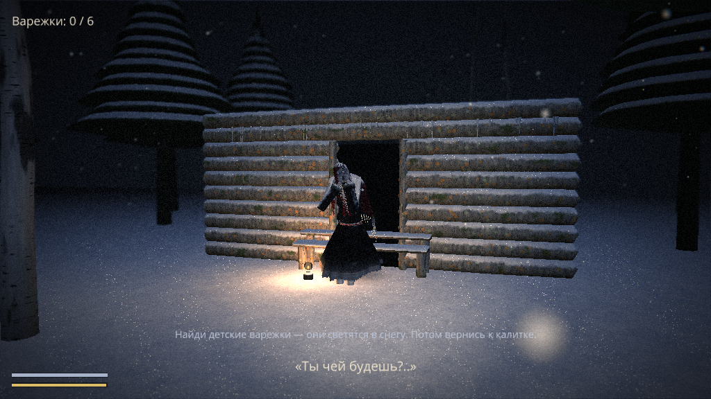
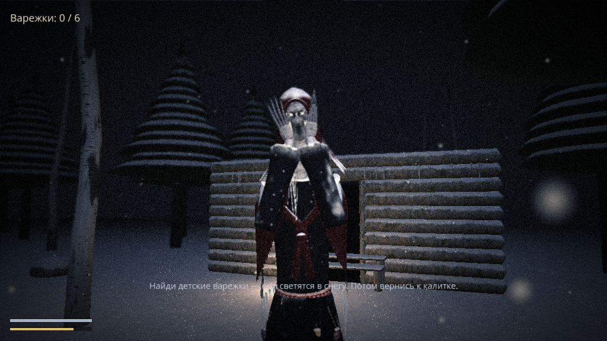

# Тайга. Бабка

Хоррор от первого лица на Python + Ursina. Зимняя ночь, в лесу разбросаны детские варежки.
Собери все шесть и уйди через калитку. На крыльце избы сидит Бабка.




## Запуск

```bash
pip install ursina
python game.py                    # --quality low | medium | high   --fullscreen
```

| Клавиша | Действие |
|---|---|
| W A S D, мышь | ходить, смотреть |
| Shift | бежать — тратит силы, Бабка слышит издалека |
| Ctrl | красться — тихо и медленно, хуже видно |
| F | фонарь — садит батарею и выдаёт тебя; луч в лицо ослепляет её на пару секунд |
| Esc | пауза (Q — выйти) |
| R | заново после конца игры |

## Как это работает

- **Цель:** 6 варежек светятся в снегу; после последней калитка на юге загорается — дойди до неё.
- **Бабка** сидит на крыльце, пока не услышит или не увидит тебя. Слышит бег за 16 м, шаг за 7 м, крадущегося — за 3 м.
  Видит дальше, если у тебя включён фонарь. С каждой варежкой она быстрее. Потеряв тебя, бродит между оставшимися варежками.
- **Страх:** чем она ближе, тем сильнее темнеют края экрана, выцветает цвет, стучит сердце и слышен её шёпот.
- **Мир:** деревья, камни и изба — настоящие препятствия (и для неё тоже); за край леса не уйти.
- **Звук** синтезируется кодом при первом запуске (папка `sounds/`): ветер, хруст снега, сердцебиение, шёпот.
- **Качество:** `--quality low` для слабых ПК (~80 тыс. треугольников у Бабки), `high` — максимум (~720 тыс.).

## Остальное в репозитории

- `babka_demo.py`, `babka_trailer.py` — техно-демо и трейлер Бабки; подробности в [docs/babka](docs/babka/README.md).
- `taiga_demo.py` — мирный Кочкарь в осенней тайге ([docs/kochkar](docs/kochkar/README.md)).
- `frost_mimic_demo.py` — Ледяной двойник ([docs/frost_mimic](docs/frost_mimic/README.md)).
- `python game.py --selftest` — автопрогон игры (победа, поражение, рестарт, пауза) без участия человека.
