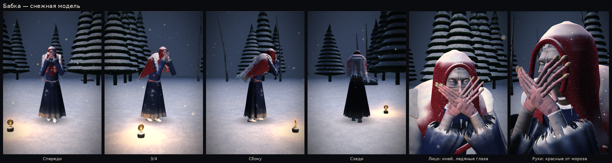
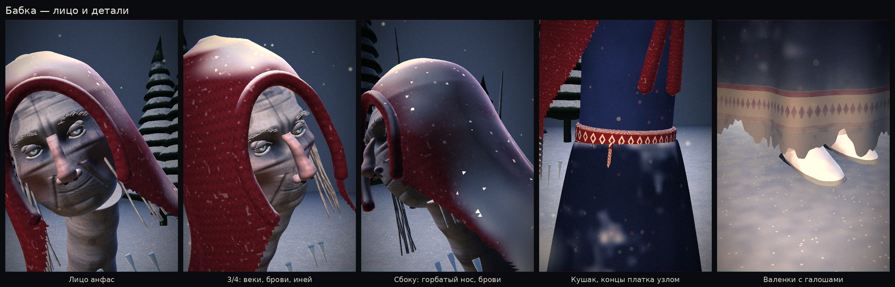
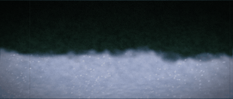
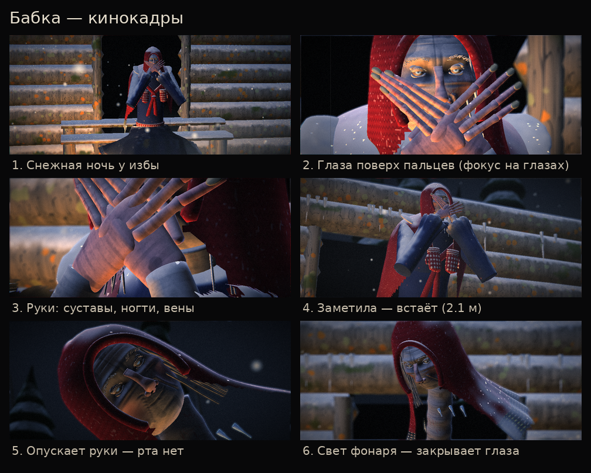
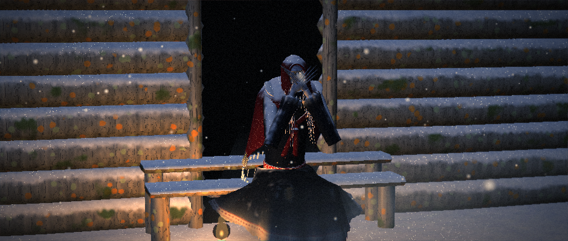
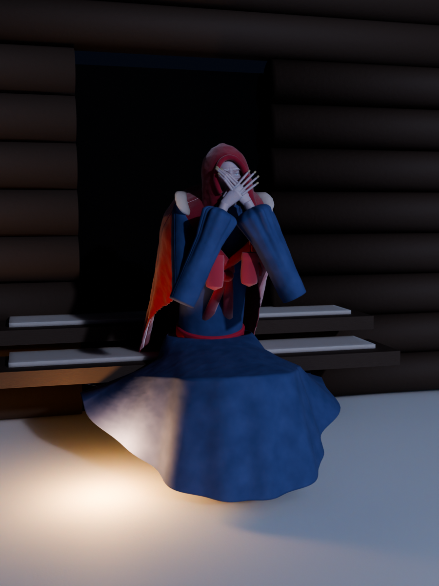
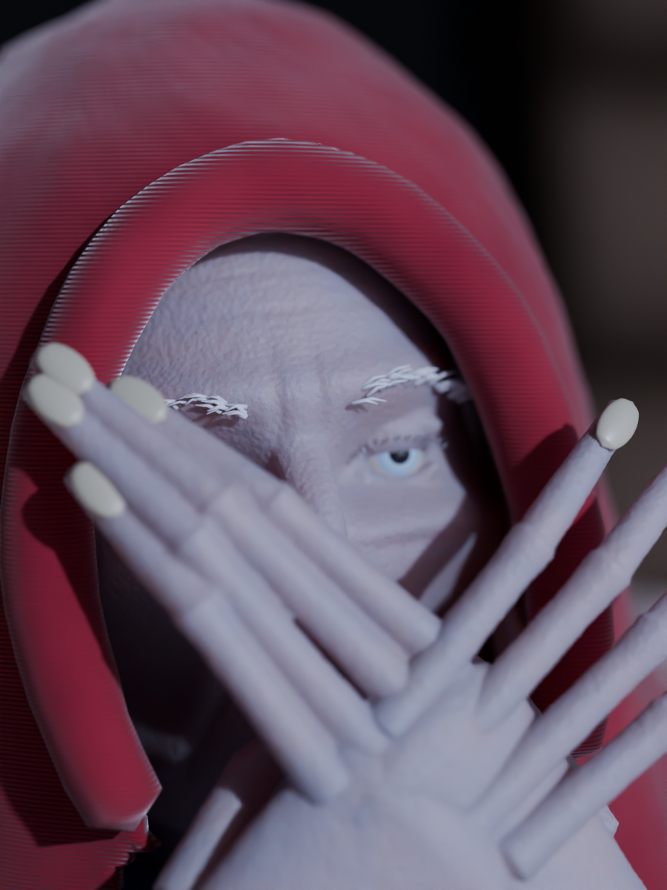
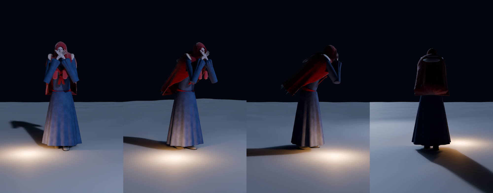

# Бабка

Враг по фото-референсу: измождённая старуха в длинном грязном покрывале сидит на ступеньке
крыльца у тёмной двери, закрыв рот ладонями, и смотрит на тебя поверх пальцев.

- Подойдёшь ближе 9 м — медленно встаёт. Она выше человека (2.1 м), руки и пальцы длинные.
- Идёт следом, не отнимая ладоней от лица. Голос глухой, из-под ладоней: «…тише…», «Посиди со мной…».
- Когда хватает — опускает руки. Рта под ними нет, только гладкая кожа.
- Свет фонаря: закрывает глаза ладонями и замирает на пару секунд.

Живость: дышит, медленно раскачивается сидя, изредка вздрагивает; моргает, глаза следят за тобой
короткими рывками; пальцы подрагивают и «постукивают» по лицу; сквозь пальцы идёт пар; край покрывала
и подол колышутся на ветру. При хватке пальцы растопыриваются и загибаются крючком.

Кино: рядом на земле керосиновая лампа — тёплый мерцающий свет снизу против холодной луны и контрового
света; пыль в воздухе, низовой туман; постобработка — глубина резкости (фокус на ней), плёночное зерно,
царапины, хроматическая аберрация, виньетка, цветокоррекция «холодные тени / тёплые света»,
кинорамка 2.35:1. Режим «старая фотография» — сепия, как на референсе.

Зима: снежная таёжная ночь. Снег копится на всём, что обращено вверх (капюшон, плечи, колени,
ступеньки, брёвна, ели), блестит в свете лампы; край ткани и подол прихвачены инеем; на ней пуховый
шерстяной платок, шерстяные чулки и валенки; нос и пальцы покраснели от мороза, в волосах иней,
пар изо рта гуще. Вокруг — снежный наст с сугробами, голые берёзы, сосульки на избе, снегопад с ветром.
Снег включается одной строкой: `set_environment(snow=1)` или `build_taiga(winter=True)`.

Снежная модель: малиновый пуховый платок с цветочной каймой и бахромой, синее платье в мелкий
выцветший цветочек, серые валенки с красной вышивкой; кожа бледная, обмороженная, щёки, нос и пальцы
красные от мороза, глаза ледяные; на капюшоне, плечах и спине лежит снег (геометрия), с края
платка и под подбородком свисают сосульки, по краям ткани иней. Лист модели: `python tools/render_babka_model.py`.

Детализация (≈660 тыс. треугольников, плотность — `DETAIL` в `monsters/babka_mesh.py`):
лицо вылеплено смещениями на плотной сетке — глазницы, надбровье, мешки и складки под глазами, скулы,
впалые щёки, носогубные складки, брыли, подбородок, морщины на лбу, «гусиные лапки», межбровные складки
и сросшийся рот; горбатый нос с крыльями и ноздрями; верхние и нижние веки, ресницы и брови в инее;
в шейдере поры, купероз, синюшность. Образ: концы пухового платка узлом на груди, тканый кушак с кистями,
варежки со снежинками на резинке, галоши на валенках, вышитая кайма по подолу.
Лист лица и деталей: `docs/babka/face.png`.







## Запуск

```bash
pip install ursina
python babka_trailer.py         # трейлер вживую (--fullscreen — на весь экран)
python babka_demo.py            # WASD, Shift — бег, F — фонарь, C — кинокамера, P — кино/фото, Tab — свободная камера
python tools/render_babka.py    # кинокадры, GIF-трейлер и кадр «как на фото»
```

## В игре

```python
from monsters.babka import Babka
from monsters.porch import build_porch

build_porch(position=(0, 0, 9), rotation_y=180)
b = Babka(position=(0, 0, 9), rotation_y=180, target=player_head, sitting=True)
b.on_say = show_subtitle
b.on_catch = game_over
b.flash()                       # игрок посветил фонарём
b.state                         # sit / rise / patrol / notice / chase / grab / caught / stunned / search
```

| Файл | Что внутри |
|---|---|
| `monsters/babka_mesh.py` | худое лицо (впалые щёки, глазницы), покрывало, платье (сидя/стоя), длинные руки |
| `monsters/babka_shaders.py` | лён с грязью и рваным краем, старая кожа, мутные глаза, сепия-постобработка |
| `monsters/babka.py` | поведение, IK рук (ладони на лицо), посадка/подъём |
| `monsters/porch.py` | крыльцо избы с тёмным проёмом |
| `monsters/cinema.py` | плёночная постобработка, керосиновая лампа, пыль и туман |


## Скульпт в Blender

`tools/blender_sculpt_babka.py` — скриптовый скульпт-проход в Blender (через модуль `bpy`) и рендер в Cycles:
руки и лицо сплавлены voxel-remesh в цельные формы и сглажены (нет швов «трубок»), мелкая скульптура
дисплейсментом (поры, морщинки), у тканей настоящая толщина и складки, материалы с подповерхностным
рассеянием кожи, ворсом шерсти, снегом и льдом.





```bash
pip install bpy                                   # нужен Python 3.13 (у bpy нет сборки под 3.14)
python tools/export_babka_pose.py sit             # поза из движка -> docs/babka/pose_sit.npz
python tools/export_babka_pose.py stand
python tools/blender_sculpt_babka.py sit --save   # рендеры + babka_sculpt.blend (полный, ~100 МБ) + babka_sculpt_lite.glb
python tools/blender_sculpt_babka.py stand        # виды спереди / 3/4 / сбоку / сзади
```

`babka_sculpt_lite.glb` (в репозитории) — прореженная копия, открывается в Blender, в любом просмотрщике glTF
и в Ursina (`Entity(model='docs/babka/babka_sculpt_lite.glb')`). Полный `.blend` в репозиторий не кладётся (слишком
большой) — его создаёт команда выше с `--save`.

Это скриптовый проход, а не ручная лепка кистью: он убирает «конструктор из трубок» и добавляет фактуру,
но для уровня AAA следующий шаг — художник докручивает этот `.blend` в Sculpt Mode.
