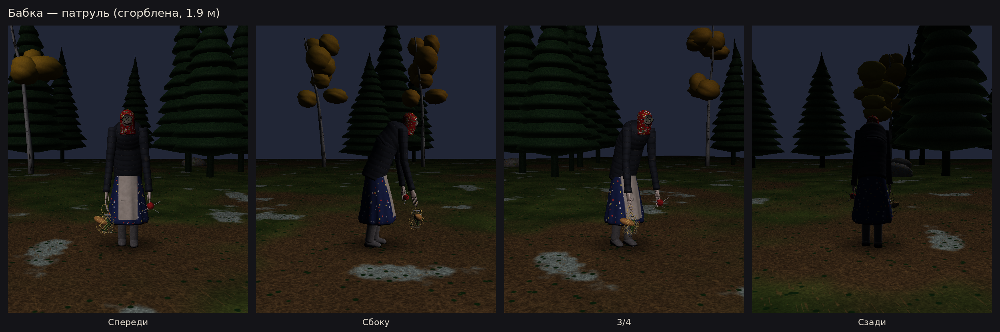
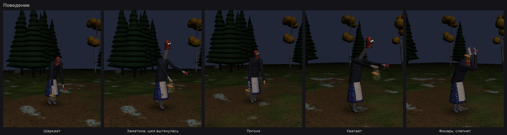
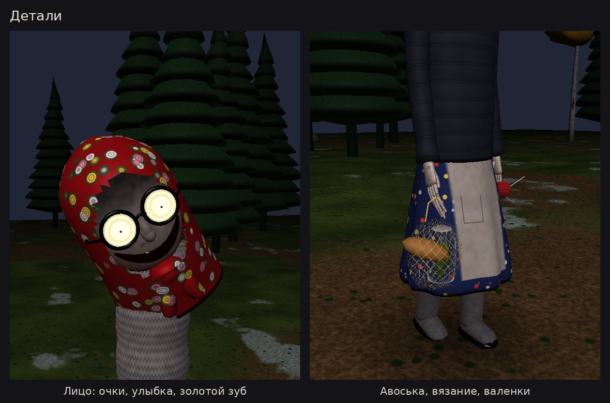

# Бабка

Враг. Советская бабушка, только неправильная.

Ростом 2.2 м, ходит сгорбившись и шаркает валенками с галошами, бормочет про огурчики и пенсию.
Платок с розами, ватник, ситцевый халат с фартуком, авоська с трёхлитровой банкой огурцов и батоном,
вязание со спицами. Лицо в тени платка: толстые круглые очки светятся мутным светом, в них —
крошечные точки зрачков; застывшая широкая улыбка с золотым зубом. Руки слишком длинные.

Заметив игрока, медленно распрямляется, шея в шерстяном шарфе вытягивается из платка (до ~3 м),
голова склоняется набок: «Внучек?..». Потом быстро шаркает следом, протянув руки: «Куда без шапки?!».
Слабость — свет: от фонаря очки слепнут, она закрывает их руками на пару секунд.





## Запуск

```bash
pip install ursina
python babka_demo.py            # от первого лица: WASD, Shift — бег, F — фонарь, Tab — свободная камера
python tools/render_babka.py    # перерисовать картинки
```

## В игре

```python
from monsters.babka import Babka

b = Babka(position=(0, 0, 9), target=player_head, waypoints=[(0, 0, 9), (6, 0, 3), (-5, 0, 2)])
b.on_say = show_subtitle        # реплики
b.on_catch = game_over          # поймала
b.flash()                       # игрок посветил фонарём
b.state                         # patrol / notice / chase / grab / caught / stunned / search
```

Настройки: `b.detect_range` (13 м), `b.lose_range` (24 м), `b.fov` (половина угла обзора, 75°).
