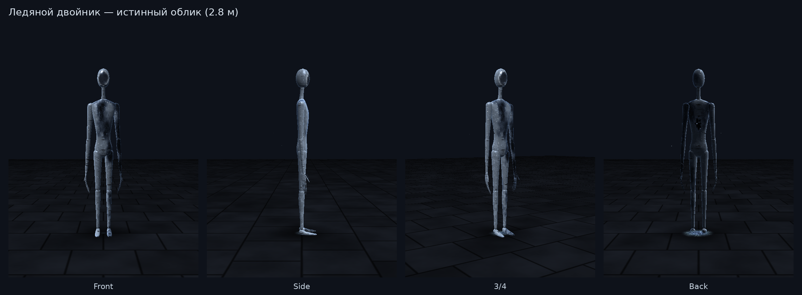
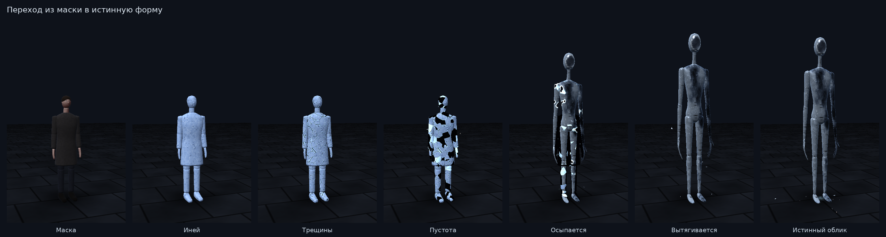
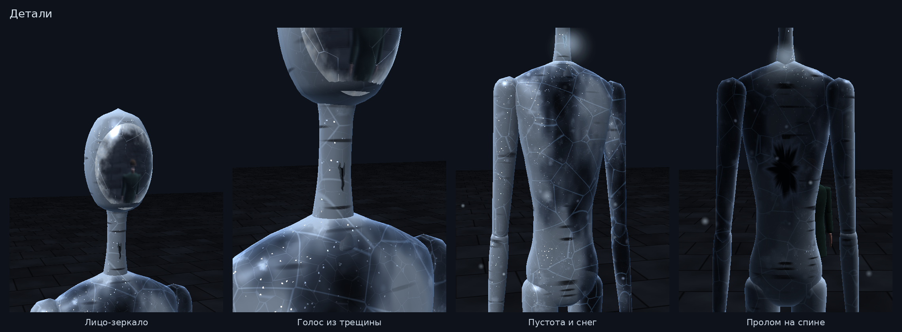
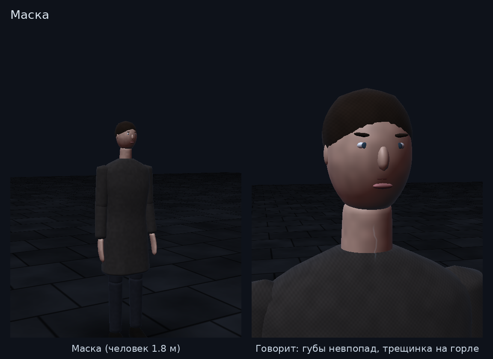

# Ледяной двойник

Процедурная модель для Ursina: меш, скелет, шейдеры и поведение.






## Запуск

```bash
pip install ursina
python frost_mimic_demo.py               # демо в коридоре лабиринта
python tools/render_frost_mimic.py       # перерисовать эти картинки
python tools/export_frost_mimic_obj.py   # OBJ для Blender (истинный облик и маска)
```

Управление в демо: **R** — маска/истинный облик, **Пробел** — говорит, **G** — идти,
**C** — скопировать внешность наблюдателя, **1–4** — виды, ПКМ — камера.

## В игре

```python
from monsters.frost_mimic import FrostMimic

mimic = FrostMimic(position=(3, 0, 5), form='mask', mirror_target=camera)
mimic.look_target = player        # голова следит за игроком (поворачивается дальше, чем может человек)
mimic.speak(2.5)                  # трещина на горле светится, губы маски опаздывают
mimic.glide_to((6, 0, 2))         # плавное скольжение, суставы почти не гнутся
mimic.reveal()                    # иней → трещины → пустота → осколки → вытягивается до 2.8 м
mimic.disguise()                  # обратно
mimic.copy_appearance({'coat': (0.2, 0.3, 0.2), 'hair': (0.4, 0.25, 0.1)})
```

## Что где

| Файл | Что внутри |
|---|---|
| `monsters/frost_mesh.py` | геометрия: лофт-трубки, голова, лицо-овал, трещина, пропорции обеих форм |
| `monsters/frost_shaders.py` | GLSL: оболочка (иней + береста + пустота со снегом), зеркало, трещина, кожа маски, иней на земле |
| `monsters/frost_mimic.py` | класс `FrostMimic`: скелет, голос, походка, превращение, частицы, камера-зеркало |

## Улики для игрока

- губы маски двигаются на 0.17 с позже голоса и в другом ритме;
- на горле маски, пока она говорит, вспыхивает тонкая трещинка;
- вокруг стоящей маски медленно появляется маленькое пятно инея (`mask_frost_clue=False` выключает);
- голова поворачивается раньше тела и дальше, чем у человека, иногда резко дёргается.
