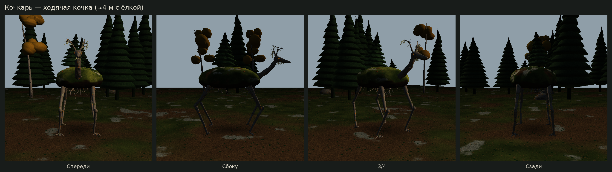
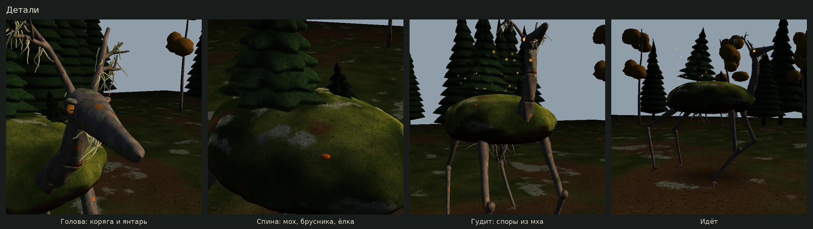
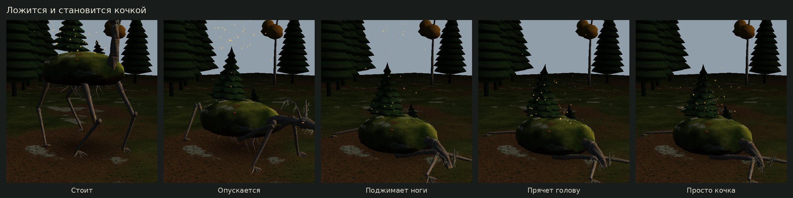

# Кочкарь

Ходячая таёжная кочка: пласт земли с мхом, брусникой, лишайником, грибами и ёлкой
на четырёх длинных ногах из выбеленных корней. Голова — вытянутый череп-коряга
с рожками-веточками и бородатым лишайником, глаза — капли светящейся смолы со спокойным
горизонтальным зрачком.

Мирный. Бродит по тайге и разносит семена. Если лечь — поджимает ноги, прячет голову
и становится обычной кочкой с ёлкой. Если «гудит» — глаза разгораются, из мха поднимаются споры.
Идеи для игры: за ним можно идти к выходу; под ним можно спрятаться; кочка на поляне может оказаться им.





## Запуск

```bash
pip install ursina
python taiga_demo.py            # G — идти, R — лечь/встать, Пробел — гудеть, L — смотреть на камеру, 1-4 — виды
python tools/render_kochkar.py  # перерисовать картинки
```

## В игре

```python
from monsters.kochkar import Kochkar

k = Kochkar(position=(0, 0, 0), resting=True)   # лежит кочкой
k.wake(); k.walk_to((5, 0, 8))                  # встаёт и идёт (шаги диагональными парами, IK ног)
k.hum()                                         # гудит
k.look_target = player                          # голова следит за игроком
k.rest()                                        # ложится
```

| Файл | Что внутри |
|---|---|
| `monsters/kochkar_mesh.py` | геометрия: кочка, ноги-корни, шея, череп, рожки, лишайник, ёлка, берёза |
| `monsters/kochkar_shaders.py` | мох с брусникой и кладонией, коряга с лишайником, хвоя, янтарные глаза, лесная подстилка |
| `monsters/kochkar.py` | поведение: ходьба с IK, лёжка, гудение, моргание, взгляд, споры |
