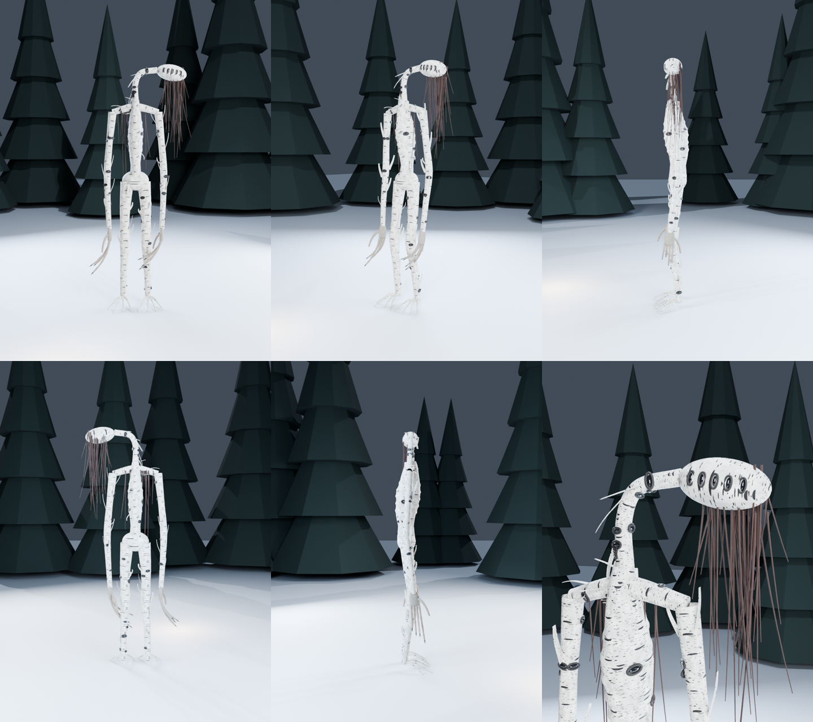

# «Берёзник» — 3D-модель таёжного монстра для Unity



Тощая фигура ростом под 3,5 метра, целиком из бересты. Шея сломана набок,
и голова висит горизонтально. С неё, как волосы, свисают плакучие ветки.
Чёрные чёрточки на берёзе — это **глаза**: на гладком лице их пять в ряд и ещё
десятки по всему телу. Береста лоскутами отслаивается от рёбер. Руки до колен
кончаются бледными человеческими кистями.

Стоит в березняке и почти не отличается от деревьев. Пока не моргнёт.

Круговой облёт — `Previews/Bereznik_turntable.gif`.

## Характеристики

| | |
|---|---|
| Формат | FBX (`Model/Bereznik.fbx`), 1 меш |
| Полигоны | ~87 000 треугольников |
| Текстуры | 1024×1024, бесшовные, albedo + normal |

| Материал | Что это |
|---|---|
| Bereznik_Birch | тело, береста (текстура) |
| Bereznik_Skin | кисти (текстура) |
| Bereznik_Twigs | плакучие ветки |
| Bereznik_Lid | тёмные веки вокруг глаз |
| Bereznik_Eye | глаза |

## Импорт в Unity

1. Скопируй в `Assets/` папки **`Model`** и **`Textures`** (Previews не нужна).
2. Выдели все `*_Normal.png` → **Texture Type: Normal map** → Apply.
3. Выдели FBX → вкладка **Materials** → **Extract Materials…**.
4. В материалах с текстурами поставь в слот **Normal Map** соответствующую `*_Normal.png`.

Единицы — метры, опорная точка на земле, «лицом» смотрит вдоль +Z.
Подходит для URP, HDRP и встроенного рендера.

## Пересборка

```bash
python tools/monsters/textures_variants.py unity
python tools/monsters/build_variants.py unity Bereznik     # --no-render = только FBX
```
