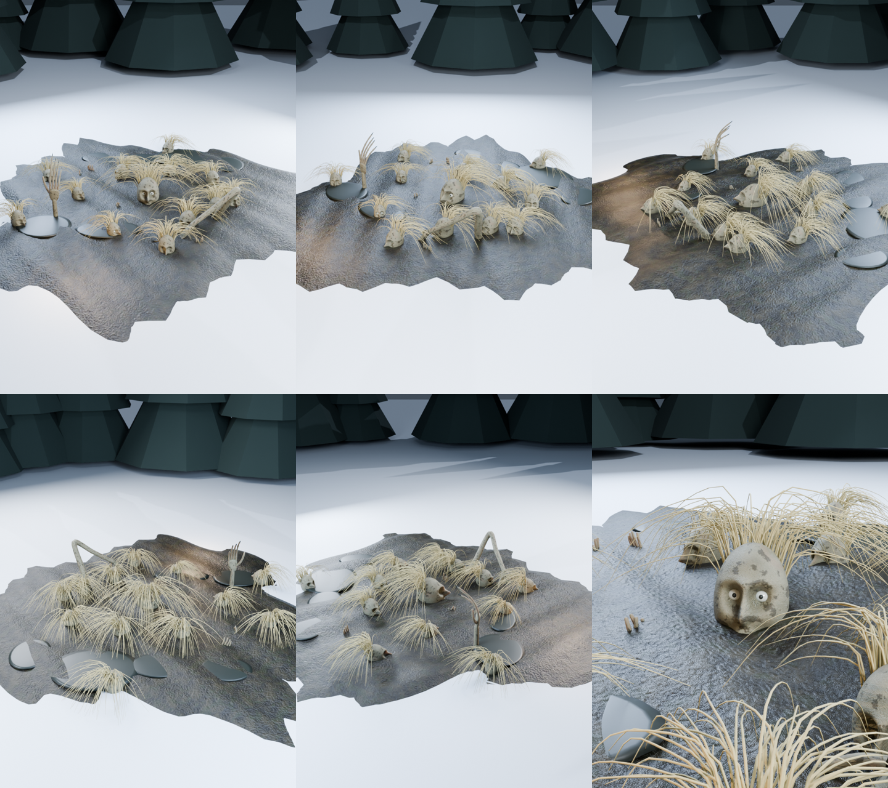

# «Кочкарник» — 3D-модель таёжного монстра для Unity



Кусок таёжного болота. Каждая кочка — человеческая голова, закопанная по нос,
а осока на ней — её волосы. У большинства глаза закрыты, но у нескольких открыты
и смотрят на тебя. Из грязи выползает длинная рука и ложится на кочку, другая
тянется вверх из лужи, а по краям из ила торчат кончики пальцев.

Ставится на землю как готовый участок болота. Можно сделать так, чтобы глаза
открывались, когда игрок подходит ближе.

Круговой облёт — `Previews/Kochkarnik_turntable.gif`.

## Характеристики

| | |
|---|---|
| Формат | FBX (`Model/Kochkarnik.fbx`), 1 меш |
| Полигоны | TRIS треугольников |
| Текстуры | 1024×1024, бесшовные, albedo + normal |

| Материал | Что это |
|---|---|
| Kochkarnik_Mud | болото (текстура) |
| Kochkarnik_Skin | головы, руки, пальцы (текстура) |
| Kochkarnik_Sedge | осока-волосы |
| Kochkarnik_Water | лужи и зрачки |
| Kochkarnik_Eye | глазные яблоки |

## Импорт в Unity

1. Скопируй в `Assets/` папки **`Model`** и **`Textures`** (Previews не нужна).
2. Выдели все `*_Normal.png` → **Texture Type: Normal map** → Apply.
3. Выдели FBX → вкладка **Materials** → **Extract Materials…**.
4. В материалах с текстурами поставь в слот **Normal Map** соответствующую `*_Normal.png`.

Единицы — метры, опорная точка на земле, «лицом» смотрит вдоль +Z.
Подходит для URP, HDRP и встроенного рендера.

## Пересборка

```bash
python tools/monsters/textures_variants.py unity
python tools/monsters/build_variants.py unity Kochkarnik     # --no-render = только FBX
```
