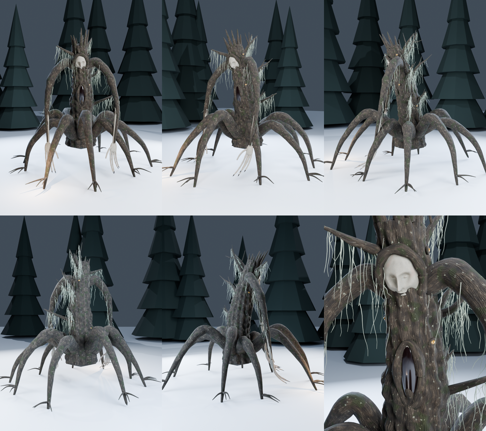

# «Корневик» — 3D-модель таёжного монстра для Unity



Мёртвая ель, вставшая на корни, как паук. Головы нет: вместо неё сломанная
верхушка. На стволе — вросшее в кору человеческое лицо с закрытыми глазами, ниже —
вертикальная пасть с зубами-щепками. Руки-ветви почти до земли кончаются бледными
человеческими кистями: в каждом пальце на одну фалангу больше, чем надо.
В коре — влажные глаза-сучки, с веток свисает лишайник-бородач.

Зимой он стоит среди сухостоя и ничем не отличается от выворотня.
Пока не откроет глаза лицо.

Круговой облёт — `Previews/Korenik_turntable.gif`, крупный план — `Previews/Korenik_face.png`.

## Характеристики

| | |
|---|---|
| Формат | FBX (`Model/Korenik.fbx`) |
| Полигоны | ~109 000 треугольников, 1 меш |
| Размер | высота ~3,7 м, размах корней ~4,2 м; в Unity единицы — метры |
| Опорная точка | на земле, в центре между корнями; лицо смотрит вдоль +Z |
| Материалы | 5: Bark, Skin, Lichen, Maw, Eye |
| Текстуры | 1024×1024, бесшовные: albedo + normal для коры и кожи |

## Импорт в Unity

1. Скопируй в `Assets/` папки **`Model`** и **`Textures`** (Previews не нужна).
2. Выдели обе нормал-карты (`*_Normal.png`) → в инспекторе
   **Texture Type: Normal map** → Apply.
3. Выдели `Korenik.fbx` → вкладка **Materials** → **Extract Materials…** → выбери папку.
   Unity сама подцепит albedo из `Textures`.
4. В извлечённых материалах `Korenik_Bark` и `Korenik_Skin` укажи в слоте
   **Normal Map** соответствующую `*_Normal.png`.
5. Перетащи модель в сцену. Для коллизий хватит **Capsule Collider**
   (радиус 0,5, высота 3, центр Y = 1,5).

Подходит для URP, HDRP и встроенного рендера.

## Советы для сцены

- Поставь его среди настоящих сухих деревьев: издалека он должен выглядеть как коряга.
- Лицо светлее коры — подсвети его слабым Spot Light сверху, остальное держи в темноте.
- Материал `Korenik_Eye` можно сделать чуть светящимся (Emission), чтобы глаза-сучки
  блестели в темноте.

## Как пересобрать

Модель, текстуры и превью генерируются кодом в `tools/korenik/`:

```bash
python tools/korenik/textures.py unity/Korenik/Textures   # numpy + pillow
pip install bpy numpy
python tools/korenik/build_korenik.py unity/Korenik       # --no-render = только FBX
```

Форму можно менять прямо в `build_korenik.py`: число корней, длину рук, рост,
количество лишайника, черты лица (функция `face_shape`).
