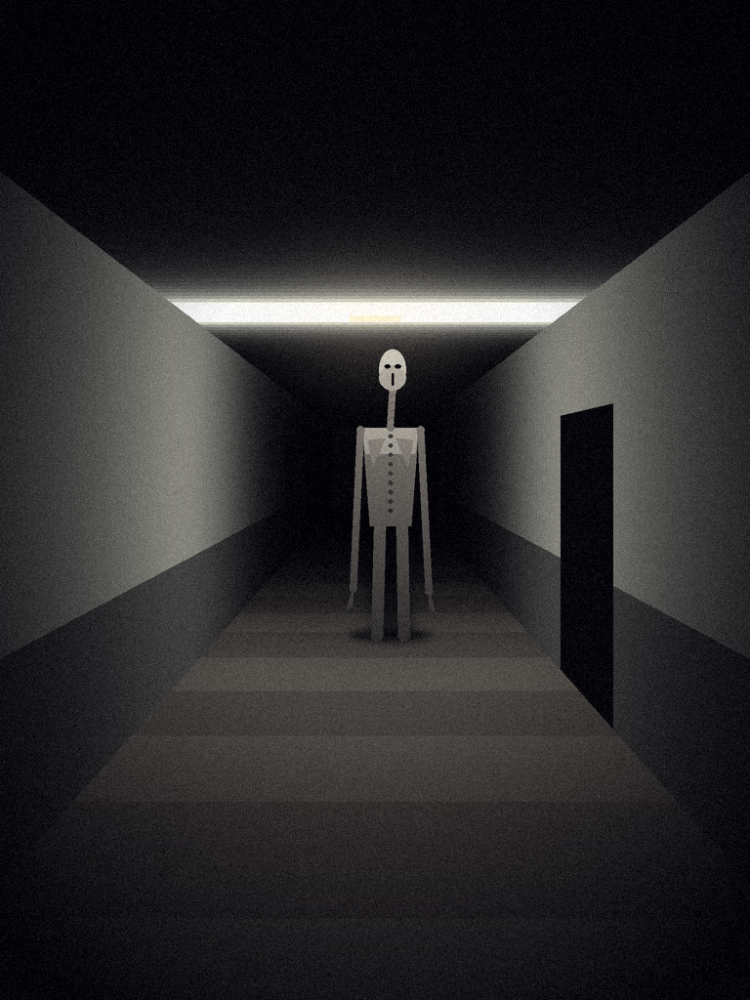

# «Лишний» — монстр для Unity 6

> Посчитай людей в комнате. Пересчитай ещё раз.
> Всегда получается на одного больше.

Он пугает не внешностью, а правилами, которые игрок понимает слишком поздно.

## Как он себя ведёт

1. **Лишний шаг.** Каждый твой шаг звучит дважды, с небольшой задержкой. Когда ты
   останавливаешься, слышен ещё один шаг — уже не твой.
2. **Он не ходит, пока ты смотришь.** Когда ты его не видишь, он переставляется
   ближе. Обычно — сзади и сбоку, туда, куда ты обернёшься.
3. **Край глаза.** Если он виден только краем глаза, он медленно идёт к тебе.
   Посмотришь прямо — замирает.
4. **Голова.** Часто он стоит к тебе спиной. Если долго смотреть, голова медленно
   поворачивается на 180°, а тело остаётся на месте. Через 2,5 секунды свет мигает,
   и он исчезает.
5. **За спиной.** Когда он подходит вплотную, лицо у него становится
   «человеческим»: два провала и вертикальный рот. Слышно дыхание. Чтобы спастись,
   нужно 8 секунд **идти, не оборачиваясь и не останавливаясь**.
   Обернулся или встал — конец.

## Установка

1. Скопируй папку `Lishniy` в `Assets/` своего проекта на Unity 6
   (подойдёт URP, HDRP или встроенный рендер).
2. В иерархии сцены: **ПКМ → Монстры → Лишний**. Или создай пустой объект и добавь
   компонент `LishniyAI`.
3. У игрока должна быть камера с тегом `MainCamera` и коллайдер или
   CharacterController. Подойдёт любой FPS-контроллер, например
   *Starter Assets – First Person*.
4. Нужен пол с коллайдером и стены с коллайдерами: за них он прячется.
5. Point- и Spot-источники света в радиусе 10 м будут мигать.
6. Чтобы после поимки сцена перезапускалась, добавь её в
   **File → Build Profiles → Scene List**. Или выключи `Reload Scene On Catch`
   и подпишись на событие `On Caught`.

Модели, текстуры и звуки не нужны: тело собирается из примитивов, звуки
генерируются кодом. Свои звуки можно подставить в инспекторе.

## Как сделать страшнее

- Узкие коридоры, много дверных проёмов и поворотов.
- Тусклый свет: несколько Point Light с маленьким радиусом.
- Без музыки. Гул монстра становится громче по мере приближения, и этого
  достаточно.
- Не рассказывай игроку правило «не оборачивайся». Пусть узнает сам.

## Настройки (инспектор `LishniyAI`)

| Параметр | Что делает |
|---|---|
| Start Distance | на каком расстоянии он появляется |
| Approach Step | на сколько метров приближается за одну перестановку |
| Relocate Interval | раз в сколько секунд переставляется |
| Max Gaze Time | сколько можно смотреть на него, прежде чем он исчезнет |
| Head Turn Speed | скорость поворота головы (медленнее — страшнее) |
| Survive Time | сколько секунд идти, не оборачиваясь, чтобы он отстал |
| Stop Grace | сколько можно стоять, когда он за спиной |
| Extra Step Chance | шанс услышать «лишний» шаг после остановки |

Картинка рисуется скриптом `tools/draw_lishniy.py`.
