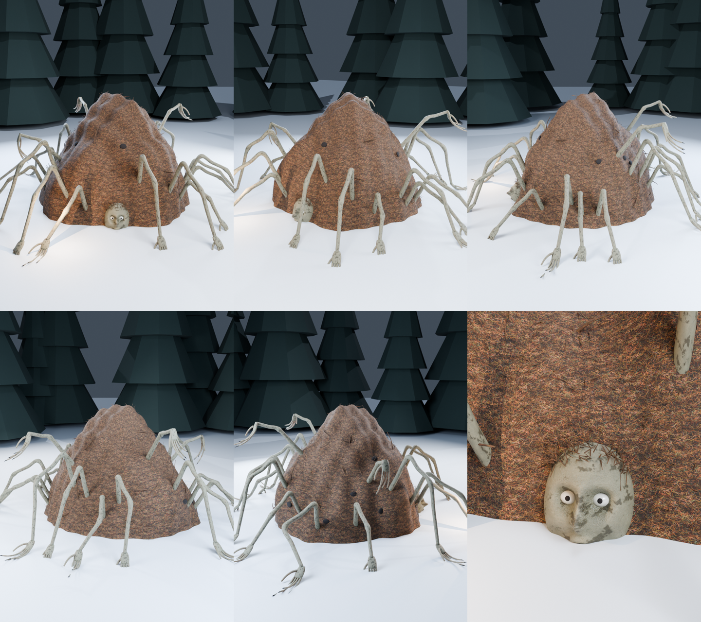

# «Муравейник» — 3D-модель таёжного монстра для Unity



Огромный муравейник в человеческий рост, сложенный из хвои. Из него во все стороны
торчат длинные серые человеческие руки, у каждой по **два локтя**. Ими он
переползает, как паук. Часть рук тянется вверх и висит кистями вниз, будто зовёт.
У самой земли из-под хвои выглядывает человеческое лицо с открытыми глазами
и маленькими зрачками: тот, кого он уже забрал.

Зимой выглядит как обычный муравейник под снегом. Только муравейники не ходят.

Круговой облёт — `Previews/Muravejnik_turntable.gif`.

## Характеристики

| | |
|---|---|
| Формат | FBX (`Model/Muravejnik.fbx`), 1 меш |
| Полигоны | TRIS треугольников |
| Текстуры | 1024×1024, бесшовные, albedo + normal |

| Материал | Что это |
|---|---|
| Muravejnik_Needles | купол и хвоинки (текстура) |
| Muravejnik_Skin | руки и лицо (текстура) |
| Muravejnik_Hole | ходы муравьёв, зрачки |
| Muravejnik_Eye | глазные яблоки |
| Muravejnik_Strand | запасной слот |

## Импорт в Unity

1. Скопируй в `Assets/` папки **`Model`** и **`Textures`** (Previews не нужна).
2. Выдели все `*_Normal.png` → **Texture Type: Normal map** → Apply.
3. Выдели FBX → вкладка **Materials** → **Extract Materials…**.
4. В материалах с текстурами поставь в слот **Normal Map** соответствующую `*_Normal.png`.

Единицы — метры, опорная точка на земле, «лицом» смотрит вдоль +Z.
Подходит для URP, HDRP и встроенного рендера.

## Пересборка

```bash
python tools/monsters/textures_variants.py unity
python tools/monsters/build_variants.py unity Muravejnik     # --no-render = только FBX
```
